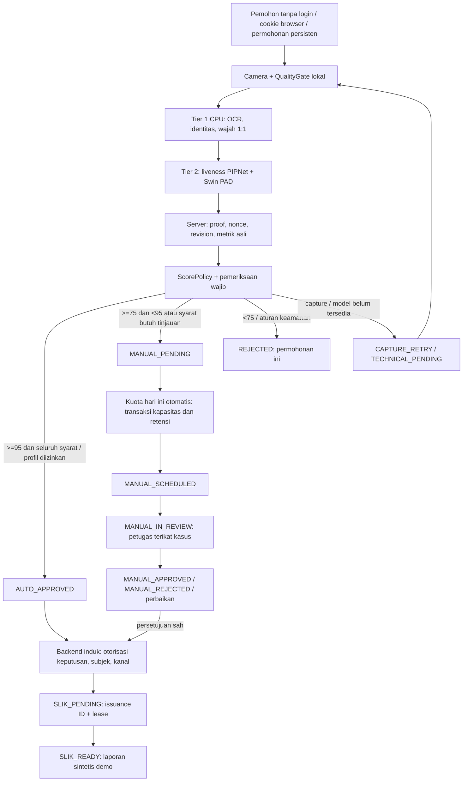

# Demo verifikasi dan permohonan persisten

Profil ini **bukan layanan resmi OJK**, tidak memanggil Dukcapil/SLIK resmi dan tidak mengirim email. Status AUTO_APPROVED/MANUAL_APPROVED pada demo mengizinkan **hasil sintetis saja**. Identitas resmi tetap `identity_verified=false`. Semua fasilitas dan subjek dalam laporan berlabel **DEMO — BUKAN INFORMASI DEBITUR RESMI**. Nama/mask NIK pada pembungkus laporan menunjukkan permohonan server yang diputuskan, bukan data keuangan orang tersebut.

## Alur dan batas kepercayaan



State machine diperiksa backend, bukan oleh field browser. Kamera berumur 15 menit, dengan maksimal tiga sesi kamera per permohonan, tiga final attempts per sesi, tiga pengambilan OCR, tiga retake per tahap dan tiga rekaman liveness. Rate limit login, signup, capture, write dan session start disimpan di DB. Angka adalah contoh demo, bukan SOP OJK. Sesi expired membutuhkan capture baru; **keputusan manual, kasus, bukti, jadwal dan hasil tetap tersedia setelah restart**.

## Pemohon

1. `npm run setup`, `npm start`, buka localhost:4173.
2. Langsung pilih Pendaftaran → Perseorangan, tanpa login. Browser memperoleh kapabilitas acak 256-bit melalui cookie HttpOnly/SameSite Strict. Permohonan/hasil hanya tersedia pada browser yang memegang cookie tersebut. Login tetap diperlukan petugas.
3. Setujui pemrosesan dan pernyataan permohonan untuk diri sendiri. OCR, selfie/gerakan dan foto memegang KTP memakai model sebenarnya. Nama/tanggal lahir harus lengkap; NIK berasal dari OCR. KTP tidak dikirim ke pihak luar pada profil lokal.
4. QualityGate browser memberi panduan blur, cahaya dan silau dengan **heuristik demo**, serta posisi dari kotak wajah terakhir yang diberikan server. Ia tidak memiliki model visibilitas wajah baru. Server tetap memeriksa wajah/penutup, NIK, wajah 1:1, PAD dan proof. Bila model kualitas yang sesuai tersedia, `QualityGate.loadOnnx` mendukung runtime ONNX Runtime Web yang disediakan aplikasi induk, WASM default, bytes model dengan SHA-256, kontrak RGB NCHW [1,3,N,N] 0–1 dan output probabilitas kualitas tunggal. Tidak ada model kualitas fiktif atau unduhan browser/CDN otomatis.
5. Hasil MANUAL_PENDING otomatis mengambil satu kuota **hari ini** dalam transaksi atomik. Sebelum jam buka, slot hari ini dapat dipesan untuk pemeriksaan saat layanan buka. Setelah jam tutup, hari libur atau kuota penuh, tetap MANUAL_PENDING dengan pesan dan hari kerja berikutnya sebagai petunjuk (bukan janji/reservasi). Klik Cek kuota hari ini lagi pada hari kerja berikutnya; bukti/revisi yang sama dipakai selama retensi masih berlaku. Pemohon tidak memilih jadwal mendatang.
6. Buka Permohonan saya untuk status, catatan petugas, batalkan reservasi, lengkapi pendaftaran atau buka hasil sintetis setelah persetujuan. Tidak ada email pengiriman hasil. Kanal demo adalah dashboard yang membutuhkan cookie browser pemilik yang sama. Menghapus cookie atau memakai perangkat/browser lain kehilangan akses; tidak ada pemulihan identitas/email yang belum diverifikasi. Cookie bukan bukti identitas atau kewenangan resmi.

## Helpdesk dan admin

Buat akun tanpa sandi bawaan/credential dalam Git:

```bash
npm run user:create -- --login helpdesk-demo --role helpdesk
npm run user:create -- --login administrator-demo --role admin
```

Perintah meminta sandi di terminal, tidak di argument/log. Pilih Akses petugas untuk login operator. Cookie petugas terpisah dari cookie pemohon; logout petugas tidak menghapus permohonan browser. Helpdesk melihat kasus yang belum diambil atau ditugaskan kepadanya. Klik kasus → Mulai pemeriksaan pada tanggal dan jam yang dipesan. Periksa foto, bukti proof, hasil model, alasan, identitas resmi dan kewenangan. Keputusan harus menyebut revisi bukti yang sedang diperiksa dan catatan dasar. Tombol identitas/kewenangan mencatat **pemeriksaan manual demo**; tidak mengubah hasil Dukcapil menjadi resmi. Persetujuan produksi ditahan jika prosedur wajib belum terpenuhi.

Administrator melihat volume setiap state, antrean, observasi retry, gangguan teknis, rata-rata latensi verifikasi dan waktu tunggu, runtime/fallback; ia mengubah kapasitas/jadwal/retensi dan ambang. Admin tidak boleh membuat keputusan helpdesk melalui tombol review. Untuk mencoba capture sebagai admin di demo, hanya permohonan yang dimiliki akun itu sendiri dapat diakses; admin tidak mendapatkan nonce milik pemohon lain. Akun integration hanya untuk backend induk, tidak untuk UI pemohon atau inference worker.

## Kapasitas dan retensi

Default [config/capacity-demo.json](../config/capacity-demo.json): Asia/Jakarta, Senin–Jumat, 08:00–17:00, 10 kasus/hari, horizon 14 hari, retensi bukti 21 hari, keputusan berlaku 24 jam setelah persetujuan. Hari libur harus diisi admin; daftar default kosong **bukan kalender libur resmi**. Pemilihan jadwal yang melampaui retensi bukti ditolak, bukan memperpanjang retensi diam-diam.

Transaksi SQLite `BEGIN IMMEDIATE` / PostgreSQL advisory transaction lock menyatukan cek kapasitas, kasus unik, perubahan jadwal, idempotency dan update aplikasi. Hanya kasus manual memakai kuota. Kasus selesai tetap dihitung sebagai kapasitas yang digunakan hari itu; pembatalan sebelum pemeriksaan mengembalikan kapasitas. Kasus IN_REVIEW/COMPLETED tidak dapat dibatalkan/dipindahkan sebagai reservasi biasa. Jika slot terakhir habis, admission menyimpan `CAPACITY_FULL`; bukti dipertahankan dan UI menawarkan pemeriksaan kuota hari ini lagi pada hari kerja berikutnya. Kalender tersedia bagi operator untuk melihat kapasitas; endpoint reserve/move dipertahankan untuk klien terautentikasi legacy, sedangkan browser publik hanya menerima tanggal hari ini. Idempotency key dengan payload berbeda ditolak.

Bukti aktif terdiri dari foto dokumen, selfie, foto memegang KTP, hasil verifikasi/pengikat proof, identitas dan paling banyak tiga frame gerakan yang relevan. Video penuh tidak disimpan. Catatan review juga tersegel. Metadata terikat `application_id`, HMAC `subject_id`, `capture_revision`, `policy_version`, jenis dan expiry melalui AEAD AES-GCM. Subjek tidak diindeks dengan SHA-256 NIK tanpa kunci. Payload permohonan, hasil model historis, receipt/contact dan display login juga tersegel; lookup akun memakai HMAC. Key-check menolak key berbeda pada startup. Migrasi menyegel payload legacy dan melakukan checkpoint/VACUUM SQLite setelah perubahan agar halaman lama tidak tetap plaintext. Backup/WAL historis di luar aplikasi tetap mengikuti kebijakan penyimpanan infrastruktur. Kunci lokal 32 byte tersimpan `data/.local.key` dengan mode 0600; folder data dan .env diabaikan Git. **Backup DB beserta kunci**, atau bukti tidak dapat dibaca setelah pindah komputer. Production wajib key dari secret manager, dibagi aman ke instance yang berwenang; rotasi key/migrasi ciphertext membutuhkan prosedur operasional tersendiri, bukan mengganti key tanpa migrasi.

Penghapusan ciphertext kedaluwarsa berjalan berkala; `npm run evidence:purge` tersedia untuk pekerjaan retensi. Metadata/audit tanpa foto/NIK lengkap tetap dipertahankan. URL bukti tidak publik/tidak berisi token; setiap akses memerlukan kapabilitas browser atau sesi petugas dan otorisasi, dicatat dalam audit, dan `no-store`. Adapter S3 memakai bucket privat dengan public access block dan ciphertext aplikasi; konten diproksi melalui backend yang mengotorisasi, tanpa public/presigned link. Pemindahan bukti ke storage privat tidak memberi worker AI akses SLIK.

## Keputusan, perubahan bukti dan SLIK

Bukti baru/retake menaikkan revisi permohonan, membatalkan keputusan/hasil aktif dan reservasi lama dalam transaksi; bukti tahap lain dalam sesi kamera yang masih valid tetap dipakai dan dicocokkan ulang. Respons capture usang ditolak. Hasil historis lama tidak otomatis menjadi keputusan baru yang berwenang.

Handoff pendaftaran mengambil identitas dari bukti server dan menolak nama browser yang berbeda. Tidak memerlukan sesi kamera aktif. Adapter SLIK memeriksa pemilik, keputusan, revision, subject HMAC, expiry, kewenangan, kanal dashboard dan bukti sebelum fetch. Stable issuance ID + unique(application,revision), lease 60 detik dan token attempt mencegah retry menghasilkan laporan baru atau respons attempt lama mengganti hasil baru. Adapter downstream resmi **harus** menjamin idempotensi ID ini, termasuk setelah timeout ambigu. Failure tetap SLIK_PENDING; tidak ada janji selesai dalam hitungan detik.

REJECTED berlaku pada permohonan ini. Ada informasi bantuan/peninjauan keberatan, tanpa pemblokiran permanen orang. Sinyal PAD yang melanggar aturan keamanan tidak masuk antrean helpdesk biasa; classifier ViT tetap advisory. Demo belum menyediakan sistem tiket keamanan/appeal eksternal: pesan tidak dikirim dan peninjauan dilakukan lewat host/helpdesk yang berwenang.

## Laporan contoh iDeb

Laporan sintetis mengikuti susunan pada PDF “Cara Membaca iDeb SLIK” yang diberikan pengguna: informasi pencarian, data pokok debitur, ringkasan fasilitas, kredit/pembiayaan, kualitas dan hari tunggakan 12 bulan, agunan, penjamin, serta legenda kode kualitas. Panduan referensi menampilkan badan usaha; demo menyesuaikan data pokok menjadi perseorangan dan tidak menampilkan pemilik/pengurus badan usaha. Nama/NIK/angka pada PDF referensi tidak disalin. Semua isi berasal dari MockSlikAdapter, berlabel sintetis; request_subject terpisah menunjukkan pemohon server. Cetak / simpan PDF membuka dialog cetak browser dan mempertahankan penanda demo. Posisi data September 2026 adalah contoh tetap, bukan data terbaru atau data pemohon.
